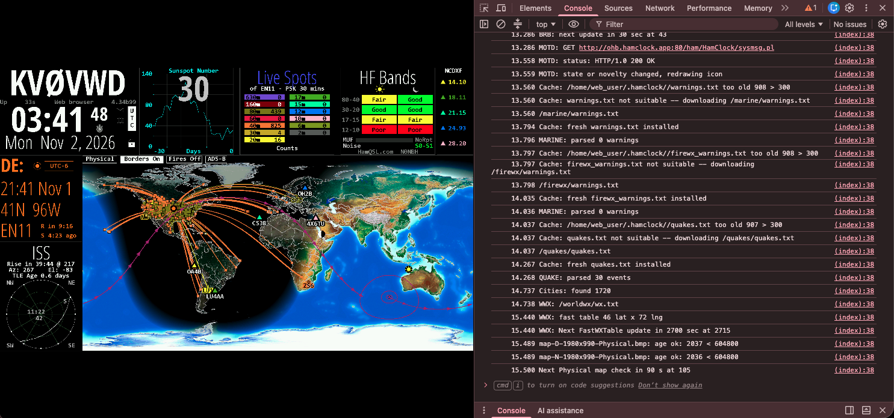

# HamClock in the browser (WebAssembly)

The [openhamclock](https://github.com/openhamclock/hamclock) C++ HamClock client, compiled to
WebAssembly so it runs entirely inside a web page, getting its data from the
[Open HamClock Backend](https://github.com/komacke/open-hamclock-backend) (OHB). There's
nothing to install and no server process per user: the page itself is the clock.


*HamClock 4.34b99 running in Chrome on macOS with live data from ohb.hamclock.app: PSK Reporter
spots, HamQSL band conditions, the ISS pass, the weather map and the sunspot history.*

> **Status: experimental proof of concept.** I'm sharing this so the HamClock and OHB developers
> can look at it and say whether it's worth pursuing. See [Questions](#questions-for-hamclock-and-ohb-developers).

## What this is

- The real client, not a rewrite. These patches apply to `openhamclock/hamclock` at
  [`b9db5fb`](https://github.com/openhamclock/hamclock/commit/b9db5fbe519faf84ee1350019eadb8747f1cd1e1)
  (v4.34b99) and build its existing `_WEB_ONLY` variant with Emscripten.
- The change is small: **598 lines added and 2 changed across 13 files**, in six patches. All code
  changes are inside `#if defined(__EMSCRIPTEN__)`, plus a new `hamclock-wasm` Makefile target.
  The native `hamclock-web-800x480` build has been checked with g++ after patching.
- The backend protocol is unchanged. The client still sends its usual
  `GET /ham/HamClock/... HTTP/1.0` requests. They just travel as browser requests instead of over
  raw sockets.

## Status

| | |
|---|---|
| **Works** | First-run Setup; touch, mouse and keyboard; the map and panes filled from OHB (space weather, SDO, PSK Reporter, POTA spots, band conditions, satellites, weather maps); links HamClock opens (new tab, or an in-page overlay for sites that allow framing); restarts HamClock asks for, such as restoring a saved configuration; settings that survive a page reload; all four sizes, 800x480 to 3200x1920 |
| **Tested on** | Chrome on macOS against live ohb.hamclock.app; headless Chromium on Linux (all sizes, local backend) |
| **Not tested** | Safari (including iPad), Firefox, a direct cross-origin connection to OHB |
| **Not available** | Anything that needs raw TCP or UDP: DX cluster, APRS-IS, HamAlert, rigctld, flrig, rotctld, gpsd, WSJT-X UDP. Also the RESTful API and Live Web servers (a page can't listen on ports), I2C/GPIO sensors, and the menu items a browser can't honor: upgrade, Reboot/Shutdown computer, and Restart/Exit/Factory reset HamClock (reload the page to restart; clear site data to reset) |

## Try it

Prerequisites: [Emscripten](https://emscripten.org/docs/getting_started/downloads.html) (tested
with 3.1.51), git, make and python3.

```sh
# once
git clone https://github.com/emscripten-core/emsdk.git ~/emsdk
~/emsdk/emsdk install 3.1.51 && ~/emsdk/emsdk activate 3.1.51

# each time
source ~/emsdk/emsdk_env.sh
scripts/build.sh 1600x960             # or 800x480, 2400x1440, 3200x1920; STRIP=1 for a 1.8 MB wasm
python3 dist/1600x960/devserver.py    # then open http://localhost:8000/
```

To build every size at once, for example for a release:

```sh
STRIP=1 PACKAGE=1 scripts/build_all.sh    # or name sizes: scripts/build_all.sh 800x480 1600x960
```

This runs `build.sh` once per size. Each size is a full rebuild, so allow a few minutes each. With
`PACKAGE=1` it also zips each size as `dist/hamclock-wasm-<version>-<size>.zip`, named from the
repo's tag (override with `VERSION=`). Anyone who downloads a zip still needs to run
`python3 devserver.py` from inside it: opening `index.html` directly won't work.

`build.sh` clones upstream at the pinned commit, applies `patches/`, builds and copies the page
into `dist/<size>/`. `devserver.py` serves it with the headers the browser needs and forwards
`/ohb/*` to `http://ohb.hamclock.app`.

`dist/<size>/` then contains:

- `hamclock.wasm`: HamClock itself, the compiled C++.
- `hamclock.js`: JavaScript generated by Emscripten. It loads the wasm, emulates the file system
  and system calls, runs HamClock's threads as Web Workers, and implements the Fetch API that
  patch 0001 uses for HTTP.
- `hamclock.worker.js`: a small startup script for each worker. Emscripten 3.1.58 and later put
  this code inside `hamclock.js`, so the file is empty or missing there.
- `index.html` and `devserver.py`, copied from `web/`.

Only `web/` is written by hand. The three `hamclock.*` files are regenerated on every build;
[docs/DESIGN.md](docs/DESIGN.md#what-the-build-produces) explains them.

You can change the defaults in the URL:

- `?b=host:port` sets HamClock's `-b` backend. The default is `ohb.hamclock.app:80`.
- `?backend=` sets where requests actually go: `/ohb` (the dev proxy), `/` (the page is served by
  the backend itself), or `https://host` (a server with CORS enabled).
- `?args=` passes extra HamClock command-line arguments.

## Where settings live

HamClock still reads and writes `~/.hamclock/eeprom`, which inside the wasm is
`/home/web_user/.hamclock/eeprom`. The page mounts that directory using Emscripten's IndexedDB
file system (IDBFS), so the settings file and cached maps are stored in the browser's IndexedDB,
in a database named `/home/web_user/.hamclock`. Nothing is written to a file on disk.

- **To inspect it:** Chrome DevTools → Application → Storage → IndexedDB →
  `/home/web_user/.hamclock` → `FILE_DATA`, entry `/home/web_user/.hamclock/eeprom`.
- **Settings are per origin and per browser.** `localhost:8000`, `localhost:8001` and a real
  hostname each have their own `eeprom`, and Chrome and Safari don't share. Changing the dev
  server's port means going through Setup again.
- **To start over,** clear the site's data (DevTools → Application → Clear site data). The next
  load runs Setup.
- **When it's saved:** IndexedDB is loaded before HamClock starts, then saved every 30 seconds
  and when the tab is closed or navigated away. The save on close runs asynchronously, so a
  change made in the last few seconds before closing can occasionally be lost.
- **There's no import or export yet.** The `eeprom` format is the same as the native client's,
  so a download/upload button could move a configuration between the desktop app and the
  browser.

## How it works

```
 browser main thread                         Web Worker (all of HamClock, unmodified logic)
 ─────────────────────                       ──────────────────────────────────────────────
 index.html                                  setup() / loop() as on Linux
   draw: canvas ◄── shared wasm memory ◄──── _WEB_ONLY stage framebuffer (fbThread)
   input: events ──► lock-free queue ──────► input thread → setMouse / wifi_tt / putChar
   links: new tab ◄──── one-entry url slot ◄─ input thread ◄─ openURL() (as for Live Web)
                                             WiFiClient::connect(backend_host, 80)
                                               write()  → collect the HTTP/1.0 request
                                               read()   → emscripten_fetch (sync) ──► OHB
                                                          ◄── response rebuilt as HTTP/1.0
```

- **Threads:** linked with `-sPROXY_TO_PTHREAD`, so `main()` runs in a Web Worker, where blocking
  is allowed. HamClock's own pthreads become more workers.
- **Network:** `WiFiClient` connections to port 80/443 are virtual. The request HamClock writes is
  performed on the first read with Emscripten's
  [Fetch API](https://emscripten.org/docs/api_reference/fetch.html) in synchronous mode, and the
  reply is rebuilt as an HTTP/1.0 response, so all 34 backend call sites and `httpSkipHeader()`
  work unchanged. Browsers won't let a page set `User-Agent`, so HamClock's User-Agent line is
  sent as `X-HamClock-UA`.
- **Display:** the page copies the `_WEB_ONLY` framebuffer straight from shared memory to a
  `<canvas>`, only when a frame counter says something changed.
- **Input:** the page never calls into HamClock directly (that can deadlock). Events go into a
  lock-free queue, and an input thread applies them exactly the way `liveweb.cpp` does.
- **Links:** `openURL()` hands URLs to the page the way it does for a Live Web client. The page
  opens a new tab, or an in-page overlay for sites known to allow framing. If the browser won't
  open a tab because the tap was too long ago, a bar offers the link to click instead.
- **Restarts:** HamClock can't re-run itself in a browser, so when it needs to restart (restoring
  a saved configuration, resetting to defaults), it asks the page to save settings and reload.
- **Storage:** `~/.hamclock` (the settings file and cached maps) lives in IndexedDB.

HamClock's log (`-o`) goes to the browser's DevTools console, so you can watch it work. This
shows the startup message request to the backend, cached feeds in `/home/web_user/.hamclock`
being refreshed, and the status line reading "Web browser":



More detail is in [docs/DESIGN.md](docs/DESIGN.md).

## Repository layout

```
hamclock-wasm/
├── README.md
├── LICENSE                     MIT, same as upstream
├── patches/                    git format-patch series against openhamclock/hamclock@b9db5fb
│   ├── 0001-WiFiClient-perform-HTTP-with-the-Emscripten-Fetch-AP.patch
│   ├── 0002-Platform-stubs-for-Emscripten-builds.patch
│   ├── 0003-Expose-web-only-framebuffer-and-input-to-a-browser-h.patch
│   ├── 0004-Makefile-add-hamclock-wasm-target.patch
│   ├── 0005-Hand-openURL-requests-to-the-browser-page.patch
│   └── 0006-Restart-by-reloading-the-browser-page.patch
├── web/
│   ├── index.html              host page: canvas, input, links, storage, configuration
│   └── devserver.py            local server: COOP/COEP headers + /ohb proxy (stdlib only)
├── scripts/
│   ├── build.sh                clone upstream, apply patches, build, collect dist/<size>/
│   └── build_all.sh            build.sh for every size, optionally zipped for a release
└── docs/
    ├── DESIGN.md               how it works, build flags, limitations
    ├── OHB-BACKEND.md          what a browser client needs from an OHB server
    └── screenshots/
```

## The patches

| Patch | Files | What it does |
|---|---|---|
| 0001 | `ArduinoLib/WiFiClient.{h,cpp}` | HTTP through the Emscripten Fetch API: request collection, synchronous `emscripten_fetch()`, response rebuilding, curl-pipe URLs, `HC_BACKEND_BASE` redirect, `X-HamClock-UA` |
| 0002 | `ESP8266WiFi.cpp`, `Arduino.cpp`, `setup.cpp`, `ESPHamClock.cpp` | Platform stubs: WiFi status, local IP, OS time instead of NTP, loop pacing without `getrusage()`, status-line text |
| 0003 | `Adafruit_RA8875.{h,cpp}`, new `wasm_glue.cpp` | Framebuffer access and frame counter for the page; lock-free input queue and input thread |
| 0004 | `Makefile` | `hamclock-wasm` target with `WASM_SIZE`; builds with `NO_UPGRADE`, `NO_SYSTEM_CONTROLS` and `NO_HAMCLOCK_CONTROLS`; automatic clean when the size or those defines change |
| 0005 | `qrz.cpp`, `liveweb.cpp`, `HamClock.h`, `wasm_glue.cpp` | `openURL()` always stages URLs as for Live Web; the input thread passes them to the page through a lock-free slot |
| 0006 | `ESPHamClock.cpp`, `HamClock.h`, `wasm_glue.cpp` | `doReboot()` asks the page to save settings and reload, carrying `-K`/`-0` to the next start |

To read them as commits rather than patch files:
`git am patches/*.patch` on a branch at `b9db5fb`.

## Questions for HamClock and OHB developers

1. **Upstream?** Would the openhamclock maintainers take these patches? Everything is guarded by
   `__EMSCRIPTEN__`. If so, `web/` would naturally become `ESPHamClock/wasm/`.
2. **Hosting.** The cleanest deployment is OHB serving this page from its own domain: there's
   no CORS, and per-IP rate limits and IP geolocation still see the real user.
   [docs/OHB-BACKEND.md](docs/OHB-BACKEND.md) compares the options, with NGINX sketches.
3. **User-Agent telemetry.** Is `X-HamClock-UA` acceptable for carrying what the native client
   puts in `User-Agent`? `version.pl` parses that string.
4. **Raw-TCP features.** Is the DX cluster worth a WebSocket-to-TCP relay with a destination
   allowlist, or is it out of scope for a browser client?
5. **Anything else that depends on the client?** I know about `fetchIPGeoloc.pl` (`REMOTE_ADDR`)
   and the `wx.pl` per-IP rate limit. Are there other endpoints that care about the client IP or
   User-Agent?

## Known issues

- Each backend request blocks the HamClock worker until it completes, just as the native read
  loop does. The page itself never freezes.
- There's no request timeout. Browsers don't allow one on synchronous requests, so a backend that
  accepts the connection but never answers holds that HamClock thread until the browser gives
  up. The native client gives up connecting after 8 seconds. Details are in
  [docs/DESIGN.md](docs/DESIGN.md#networking-patch-0001).
- Map hover doesn't trigger the city-marker redraw that `liveweb.cpp` does.
- `labs(time_t)` and `%ld` with `time_t` in `astro.cpp`, `liveweb.cpp` and `ESPHamClock.cpp` warn
  on wasm32, where `long` is 32 bits. They're harmless here, but could be fixed upstream for any
  32-bit target.
- The first build after a size change, a change to the compile-time defines, or a native build does a
  full rebuild, on purpose.
- Settings are saved to IndexedDB every 30 seconds and on close, not immediately after HamClock
  writes them (see [Where settings live](#where-settings-live)).

## Credits and license

HamClock was created by Elwood Downey, WB0OEW (SK). It's maintained today by the
[openhamclock](https://github.com/openhamclock) project, and the Open HamClock Backend
community keeps the data flowing.

This repository is MIT licensed, like upstream HamClock. The patches modify upstream's
MIT-licensed files, whose copyright notices still apply.

Hubert Hickman, KF0VWD
