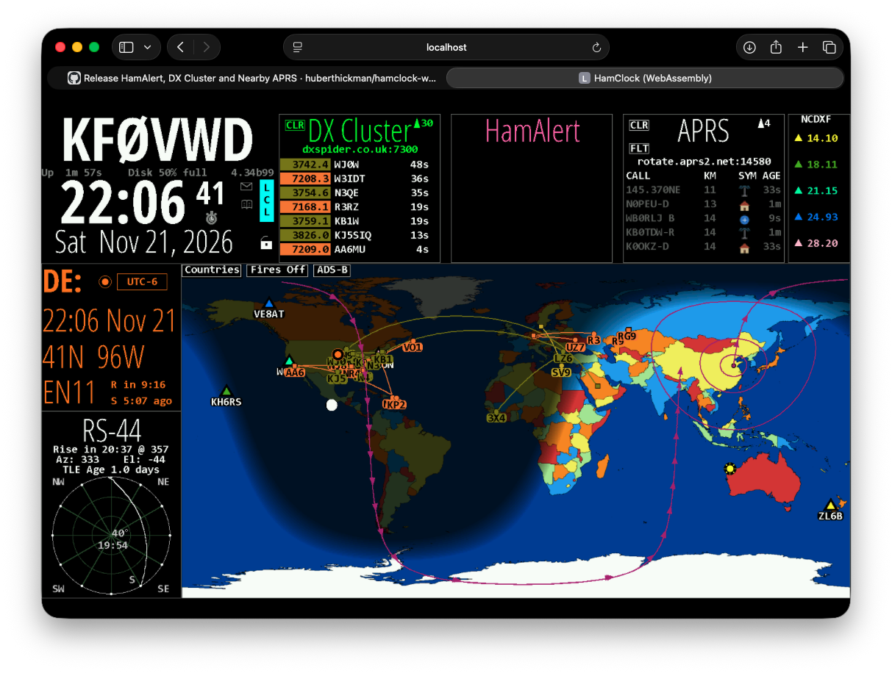
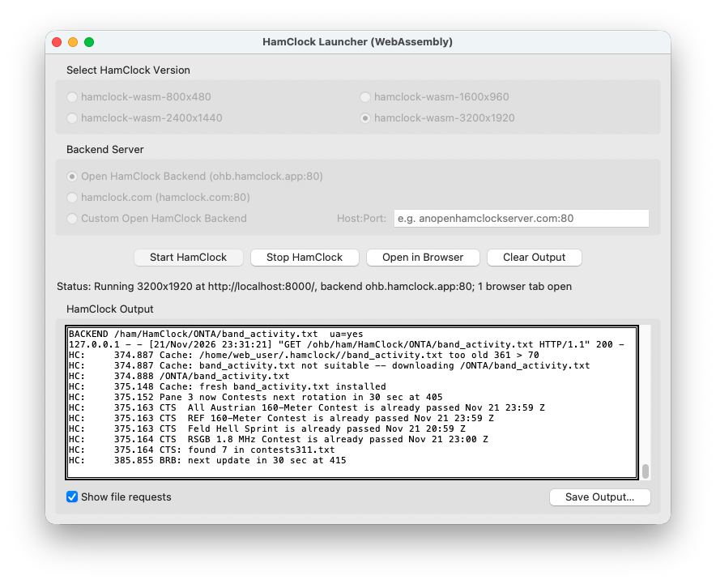
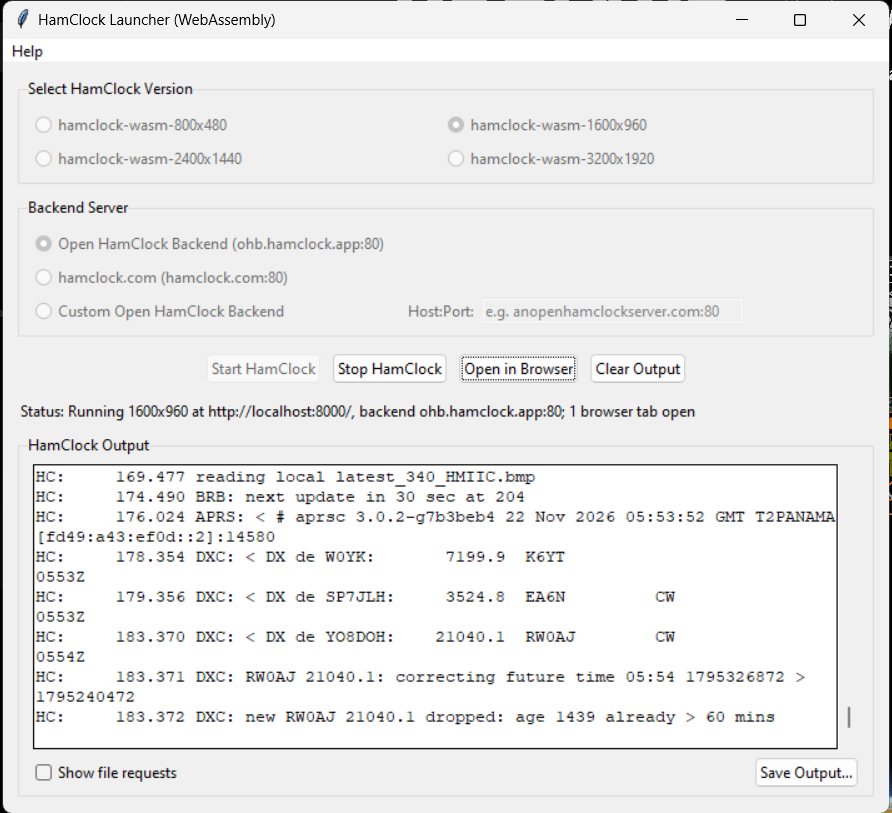
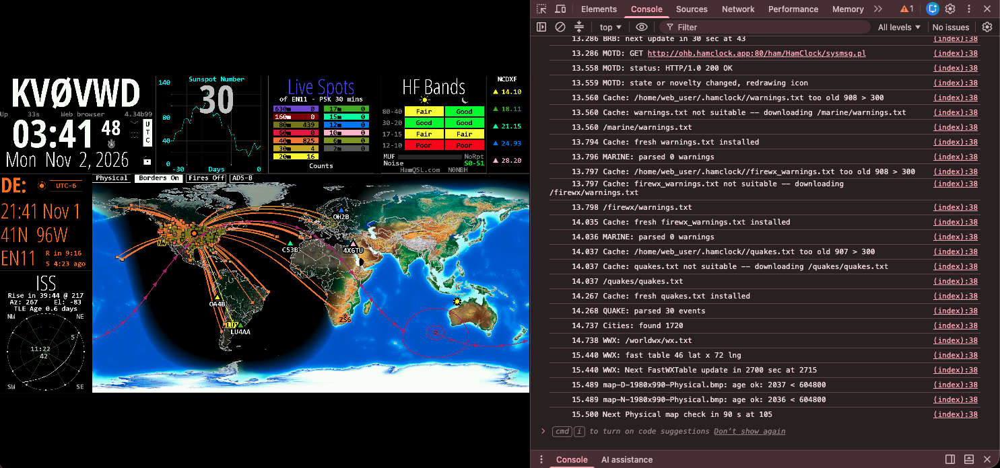

# HamClock in the browser (WebAssembly)

The [openhamclock](https://github.com/openhamclock/hamclock) C++ HamClock client, compiled to
WebAssembly so it runs entirely inside a web page, getting its data from the
[Open HamClock Backend](https://github.com/komacke/open-hamclock-backend) (OHB). There's
nothing to install and no server process per user: the page itself is the clock.



*HamClock 4.34b99 running in Safari on macOS with live data from ohb.hamclock.app. The DX
Cluster (dxspider.co.uk), HamAlert and Nearby APRS (rotate.aprs2.net) panes are connected
through `devserver.py`'s TCP relay, with the cluster's spots plotted on the map, alongside
the RS-44 satellite pass and NCDXF beacons.*

> **Status: experimental proof of concept.** I'm sharing this so the HamClock and OHB developers
> can look at it and say whether it's worth pursuing. See [Questions](#questions-for-hamclock-and-ohb-developers).

## What this is

- The real client, not a rewrite. These patches apply to `openhamclock/hamclock` at
  [`b9db5fb`](https://github.com/openhamclock/hamclock/commit/b9db5fbe519faf84ee1350019eadb8747f1cd1e1)
  (v4.34b99) and build its existing `_WEB_ONLY` variant with Emscripten.
- The change is small: **963 lines added and 2 changed across 13 files**, in nine patches. All code
  changes are inside `#if defined(__EMSCRIPTEN__)`, plus a new `hamclock-wasm` Makefile target.
  The native `hamclock-web-800x480` build has been checked with g++ after patching.
- The backend protocol is unchanged. The client still sends its usual
  `GET /ham/HamClock/... HTTP/1.0` requests. They just travel as browser requests instead of over
  raw sockets.

## Status

| | |
|---|---|
| **Works** | First-run Setup; touch, mouse and keyboard; the map and panes filled from OHB (space weather, SDO, PSK Reporter, POTA spots, band conditions, satellites, weather maps); links HamClock opens (new tab, or an in-page overlay for sites that allow framing); restarts HamClock asks for, such as restoring a saved configuration; the hams.at Sat Alerts and Meshtastic Mesh Mon panes, including a hams.at API key, through `devserver.py`'s proxy; the DX Cluster, HamAlert and Nearby APRS panes, through `devserver.py`'s TCP relay; settings that survive a page reload; all four sizes, 800x480 to 3200x1920 |
| **Tested on** | Against live ohb.hamclock.app: Chrome on macOS, Firefox on macOS and Linux, Edge on Windows, Safari on macOS. The DX Cluster (dxspider.co.uk), HamAlert and Nearby APRS (rotate.aprs2.net) panes through the TCP relay, on macOS. Also headless Chromium on Linux (all sizes, local backend) |
| **Not tested** | Safari on iPad; a direct cross-origin connection to OHB; rigctld, rotctld, flrig and gpsd through the relay (they should work with `--tcp-allow`, see [below](#hamalert-dx-clusters-and-aprs-is)) |
| **Not available** | UDP, so the DX Cluster pane's WSJT-X and other UDP spot sources. Also the RESTful API and Live Web servers (a page can't listen on ports), I2C/GPIO sensors, and the menu items a browser can't honor: upgrade, Reboot/Shutdown computer, and Restart/Exit/Factory reset HamClock (reload the page to restart; clear site data to reset) |

**Browsers:** Chrome and Firefox are recommended.

- **Safari** may report that a pop-up was blocked when HamClock opens a link. Clicking the address
  bar again opens the page.
- **The in-page overlay** for links that allow framing works only in Chrome and Edge. Other
  browsers open those links in a new tab.

## Try it

Prerequisites: [Emscripten](https://emscripten.org/docs/getting_started/downloads.html) (tested
with 3.1.51), git, make and python3.

```sh
# once
git clone https://github.com/emscripten-core/emsdk.git ~/emsdk
~/emsdk/emsdk install 3.1.51 && ~/emsdk/emsdk activate 3.1.51

# each time
source ~/emsdk/emsdk_env.sh
scripts/build.sh 1600x960             # or 800x480, 2400x1440, 3200x1920; STRIP=1 for a 1.8 MB wasm
python3 dist/1600x960/devserver.py    # then open http://localhost:8000/
```

To build every size at once, for example for a release:

```sh
STRIP=1 PACKAGE=1 scripts/build_all.sh    # or name sizes: scripts/build_all.sh 800x480 1600x960
```

This runs `build.sh` once per size. Each size is a full rebuild, so allow a few minutes each. With
`PACKAGE=1` it also zips each size as `dist/hamclock-wasm-<version>-<size>.zip`, and everything
built, with the [launcher](#the-launcher), as `dist/hamclock-wasm-<version>-all-sizes.zip`. Zips
are named from the repo's tag (override with `VERSION=`). Anyone who downloads a zip still needs
to run the launcher or `python3 devserver.py` from inside it: opening `index.html` directly
won't work.

`build.sh` clones upstream at the pinned commit, applies `patches/`, builds and copies the page
into `dist/<size>/`. `devserver.py` serves it with the headers the browser needs, forwards
`/ohb/*` to `http://ohb.hamclock.app`, forwards `/xhttp/*` to the two third-party APIs HamClock
uses that browsers can't reach directly (see [Third-party APIs](#third-party-apis)), and relays
the TCP connections of the DX Cluster, HamAlert and Nearby APRS panes (see
[HamAlert, DX clusters and APRS-IS](#hamalert-dx-clusters-and-aprs-is)). It listens on
`localhost` only; `python3 devserver.py --help` lists its options. It prints a line for each
relayed connection and anything it refuses, which is the place to look if a pane won't connect.

- **Stopping the server.** If you stop `devserver.py` (Ctrl-C), the HamClock tab covers itself with
  "HamClock's local communication process has stopped". If `devserver.py` disappears without
  stopping cleanly (a crash, or the computer sleeping), the tab shows "Can't reach HamClock's
  local communication process" after a few seconds. Either way HamClock keeps running
  underneath: start `devserver.py` again and the notice goes away and HamClock carries on. Or
  just close the tab; your settings are already saved in the browser.
- **One tab at a time.** Two HamClock tabs in the same browser would overwrite each other's
  settings, so a second tab says HamClock is already open, and starts by itself once you close
  the first.

`dist/<size>/` then contains:

- `hamclock.wasm`: HamClock itself, the compiled C++.
- `hamclock.js`: JavaScript generated by Emscripten. It loads the wasm, emulates the file system
  and system calls, runs HamClock's threads as Web Workers, and implements the Fetch API that
  patch 0001 uses for HTTP.
- `hamclock.worker.js`: a small startup script for each worker. Emscripten 3.1.58 and later put
  this code inside `hamclock.js`, so the file is empty or missing there.
- `index.html` and `devserver.py`, copied from `web/`.

Only `web/` is written by hand. The three `hamclock.*` files are regenerated on every build;
[docs/DESIGN.md](docs/DESIGN.md#what-the-build-produces) explains them.

You can change the defaults in the URL:

- `?b=host:port` sets HamClock's `-b` backend. The default is `ohb.hamclock.app:80`.
- `?backend=` sets where requests actually go: `/ohb` (the dev proxy), `/` (the page is served by
  the backend itself), or `https://host` (a server with CORS enabled).
- `?xhttp=` sets where third-party APIs are fetched through: `/xhttp` (the default, via
  `devserver.py`) or empty, to fetch them straight from the browser.
- `?tcp=` sets the TCP relay: `/tcp` (the default, via `devserver.py`) or empty for none.
- `?events=` sets the stream the page watches to tell that its server has stopped: `/events` (the
  default) or empty to not watch. A server without one is simply not watched.
- `?args=` passes extra HamClock command-line arguments.

## The launcher

`launcher.py` is a small window for starting HamClock without a terminal, laid out like the
[HamClock Launcher](https://machamclocklauncher.org) for the Mac. It's in the all-sizes release
zip and in `dist/` after a build, and needs only Python 3 with tkinter, which the
[python.org](https://www.python.org/downloads/) installers for macOS and Windows include.

```sh
python3 launcher.py                    # from the unzipped release, or: python3 dist/launcher.py
```



*The launcher on macOS, running the 3200x1920 build against ohb.hamclock.app, with one browser
tab connected. HamClock's own output (`HC:` lines) is interleaved with `devserver.py`'s; "Show
file requests" is on, so the page's file requests show too.*

On a Mac you can double-click `HamClock Launcher.command` instead. Because it was downloaded,
macOS may refuse it the first time: allow it under System Settings → Privacy & Security, or use
the command above.

On Windows, double-click `HamClock Launcher.bat`. It finds Python (the `py` command the python.org
installer adds, or `python`), checks that it has tkinter, and starts the launcher without a
console window. If Python is missing or unsuitable, it says so and how to fix it. Windows may
warn about running a downloaded file the first time: choose More info → Run anyway.



*The launcher on Windows 11, running the 1600x960 build against ohb.hamclock.app with one
browser tab connected, showing DX cluster spots and the APRS-IS server's greeting as they arrive.*

- **Choose a size and a backend:** Open HamClock Backend, hamclock.com, or your own host:port.
  Sizes not in the folder are greyed out.
- **Start HamClock** runs that size's `devserver.py` and opens HamClock in your default browser.
  If a HamClock tab is still open from before, it reconnects instead of a new one opening.
- **Stop HamClock** stops `devserver.py`. The HamClock tab then says "HamClock's local
  communication process has stopped"; close it, or press Start HamClock again.
- **Changing size:** Stop, choose another size, Start. A tab still open from before reloads
  itself at the new size. Your settings carry over, since the address stays
  `http://localhost:8000/`.
- **HamClock Output** shows `devserver.py`'s log and HamClock's own output (lines starting `HC:`),
  as the native HamClock would print it. Problems such as a refused connection are in red. "Show
  file requests" adds the routine requests for the page's files; "Save Output…" writes everything
  to a file, handy for reporting a problem.
- **The status line** says whether a browser tab is connected.
- **Settings** (size, backend, the output options) are remembered in
  `~/Library/Application Support/HamClock WebAssembly Launcher/` on a Mac,
  `%APPDATA%\HamClock WebAssembly Launcher\` on Windows and `~/.config/hamclock-wasm-launcher/`
  on Linux. The port is fixed at 8000; a `"port"` entry in `settings.json` changes it, but
  HamClock's settings are kept per port, so a new port starts afresh.

If tkinter is missing, the launcher says how to get it. Python from Homebrew needs
`brew install python-tk`, and Linux distributions package it separately (`python3-tk`). Apple's
own `/usr/bin/python3` has an outdated Tk, so python.org's Python is the better choice on a Mac.

## Where settings live

HamClock still reads and writes `~/.hamclock/eeprom`, which inside the wasm is
`/home/web_user/.hamclock/eeprom`. The page mounts that directory using Emscripten's IndexedDB
file system (IDBFS), so the settings file and cached maps are stored in the browser's IndexedDB,
in a database named `/home/web_user/.hamclock`. Nothing is written to a file on disk.

- **To inspect it:** Chrome DevTools → Application → Storage → IndexedDB →
  `/home/web_user/.hamclock` → `FILE_DATA`, entry `/home/web_user/.hamclock/eeprom`.
- **Settings are per origin and per browser.** `localhost:8000`, `localhost:8001` and a real
  hostname each have their own `eeprom`, and Chrome and Safari don't share. Changing the dev
  server's port means going through Setup again.
- **To start over,** clear the site's data (DevTools → Application → Clear site data). The next
  load runs Setup.
- **When it's saved:** IndexedDB is loaded before HamClock starts, then saved every 30 seconds
  and when the tab is closed or navigated away. The save on close runs asynchronously, so a
  change made in the last few seconds before closing can occasionally be lost.
- **There's no import or export yet.** The `eeprom` format is the same as the native client's,
  so a download/upload button could move a configuration between the desktop app and the
  browser.

## Third-party APIs

Two of HamClock's panes fetch data from services other than OHB, using curl natively:

| Pane | Service | Key |
|---|---|---|
| Sat Alerts | `https://hams.at/api/alerts/upcoming` | optional hams.at API key (Setup page 4) |
| Mesh Mon | `https://meshtastic.liamcottle.net/api/v1/nodes/…` | none; node IDs from Setup page 4 |

Neither service sends CORS headers, so browsers refuse to let a page on another site read their
responses. The page fetches them through `devserver.py` instead: `https://hams.at/api/...` becomes
`/xhttp/hams.at/api/...` on the page's own server, which forwards it with your API key and
HamClock's user agent.

- **Only those two hosts are forwarded.** Add others with `--xhttp-allow HOST`, or turn the proxy
  off with `--no-xhttp`.
- **Only this page can use it.** Requests must carry an `X-HamClock-Proxy` header, which other
  websites can't send without the browser asking first, and must be addressed to this server,
  which blocks DNS-rebinding tricks. Anything else gets a 403 with the reason in the log.
- **Your API key is forwarded, never logged.** The log only notes that a key was present.

## HamAlert, DX clusters and APRS-IS

The DX Cluster, HamAlert and Nearby APRS panes keep a plain TCP connection open to a server
(telnet-style), which browsers can't do. `devserver.py` makes those connections for the page:
HamClock asks it to connect, sends through it, and collects what arrives. The panes, their
Setup fields and their logins are unchanged.

| Pane | Connects to | Setup |
|---|---|---|
| DX Cluster | your cluster node, eg `dxc.nc7j.com:7373` | cluster host, port and login |
| HamAlert | `hamalert.org:7300` | HamAlert call and telnet password |
| Nearby APRS | an APRS-IS server, eg `rotate.aprs2.net:14580` | APRS-IS host, port and radius |

- **No router setup.** These are outgoing connections from your computer, the same ones the
  native HamClock makes. Don't forward ports to `devserver.py`: it's meant to be reached only from
  your own browser.
- **Where it may connect.** Public addresses, on port 23 or ports 1024 and up. Addresses on your
  own computer or network, and other low ports, are refused unless you allow them with
  `--tcp-allow HOST:PORT`, for example `--tcp-allow localhost:4532` for rigctld. `--no-tcp` turns
  the relay off.
- **Only this page can use it,** with the same checks as `/xhttp` above.
- **Logins pass through, and aren't logged.** The log shows each connection's host, port, byte
  counts and how it ended, never what was sent. As with the native client, the cluster and
  HamAlert logins travel unencrypted, because that's how those services work.
- **Lost connections behave as they do natively.** If `devserver.py` stops, HamClock notices
  within a few seconds and each pane shows its usual error and retries. If the page is closed or
  reloaded, `devserver.py` closes its connections within about a minute.

A typical log:

```
TCP #1 dxc.nc7j.com:7373 open
TCP #2 hamalert.org:7300 open
TCP #3 rotate.aprs2.net:14580 open
TCP refused 192.168.1.20:4532: 192.168.1.20 is a private or local address (see --tcp-allow)
TCP #2 hamalert.org:7300 closed by HamClock after 12m04s, 5810 bytes in, 61 out
```

## How it works

```
 browser main thread                         Web Worker (all of HamClock, unmodified logic)
 ─────────────────────                       ──────────────────────────────────────────────
 index.html                                  setup() / loop() as on Linux
   draw: canvas ◄── shared wasm memory ◄──── _WEB_ONLY stage framebuffer (fbThread)
   input: events ──► lock-free queue ──────► input thread → setMouse / wifi_tt / putChar
   links: new tab ◄──── one-entry url slot ◄─ input thread ◄─ openURL() (as for Live Web)
                                             WiFiClient::connect(backend_host, 80)
                                               write()  → collect the HTTP/1.0 request
                                               read()   → emscripten_fetch (sync) ──► OHB
                                                          ◄── response rebuilt as HTTP/1.0
```

- **Threads:** linked with `-sPROXY_TO_PTHREAD`, so `main()` runs in a Web Worker, where blocking
  is allowed. HamClock's own pthreads become more workers.
- **Network:** `WiFiClient` connections to port 80/443 are virtual. The request HamClock writes is
  performed on the first read with Emscripten's
  [Fetch API](https://emscripten.org/docs/api_reference/fetch.html) in synchronous mode, and the
  reply is rebuilt as an HTTP/1.0 response, so all 34 backend call sites and `httpSkipHeader()`
  work unchanged. Browsers won't let a page set `User-Agent`, so HamClock's User-Agent line is
  sent as `X-HamClock-UA`.
- **Display:** the page copies the `_WEB_ONLY` framebuffer straight from shared memory to a
  `<canvas>`, only when a frame counter says something changed.
- **Input:** the page never calls into HamClock directly (that can deadlock). Events go into a
  lock-free queue, and an input thread applies them exactly the way `liveweb.cpp` does.
- **Links:** `openURL()` hands URLs to the page the way it does for a Live Web client. The page
  opens a new tab, or an in-page overlay for sites known to allow framing. If the browser won't
  open a tab because the tap was too long ago, a bar offers the link to click instead.
- **Third-party APIs:** hams.at and the Meshtastic map don't allow requests from other websites,
  so the page fetches them through `devserver.py`'s `/xhttp/` proxy, with your hams.at API key.
- **TCP:** the DX cluster, HamAlert and APRS-IS connections go through `devserver.py`'s `/tcp/`
  relay. One background thread collects what arrives on all of them, and HamClock reads it as if
  from a socket.
- **Restarts:** HamClock can't re-run itself in a browser, so when it needs to restart (restoring
  a saved configuration, resetting to defaults), it asks the page to save settings and reload.
- **Storage:** `~/.hamclock` (the settings file and cached maps) lives in IndexedDB.

HamClock's log (`-o`) goes to the browser's DevTools console, so you can watch it work. This
shows the startup message request to the backend, cached feeds in `/home/web_user/.hamclock`
being refreshed, and the status line reading "Web browser":



More detail is in [docs/DESIGN.md](docs/DESIGN.md).

## Repository layout

```
hamclock-wasm/
├── README.md
├── .gitattributes              keeps the Windows .bat file's CRLF line endings
├── LICENSE                     MIT, same as upstream
├── patches/                    git format-patch series against openhamclock/hamclock@b9db5fb
│   ├── 0001-WiFiClient-perform-HTTP-with-the-Emscripten-Fetch-AP.patch
│   ├── 0002-Platform-stubs-for-Emscripten-builds.patch
│   ├── 0003-Expose-web-only-framebuffer-and-input-to-a-browser-h.patch
│   ├── 0004-Makefile-add-hamclock-wasm-target.patch
│   ├── 0005-Hand-openURL-requests-to-the-browser-page.patch
│   ├── 0006-Restart-by-reloading-the-browser-page.patch
│   ├── 0007-Fetch-third-party-https-APIs-through-the-page-s-prox.patch
│   ├── 0008-Relay-raw-TCP-through-the-page-s-server-HamAlert-DX-.patch
│   └── 0009-Keep-HamClock-alive-when-requests-fail-in-Safari-and.patch
├── web/
│   ├── index.html              host page: canvas, input, links, storage, configuration
│   ├── devserver.py            local server: COOP/COEP headers, /ohb and /xhttp proxies, /tcp relay,
│   │                           /events and /log for the page (stdlib only)
│   ├── launcher.py             window to choose a size and backend and run devserver.py (tkinter)
│   ├── HamClock Launcher.command   macOS: double-click to run launcher.py
│   └── HamClock Launcher.bat       Windows: double-click to run launcher.py
├── scripts/
│   ├── build.sh                clone upstream, apply patches, build, collect dist/<size>/
│   └── build_all.sh            build.sh for every size, optionally zipped for a release,
│                               with an all-sizes zip that includes the launcher
└── docs/
    ├── DESIGN.md               how it works, build flags, limitations
    ├── OHB-BACKEND.md          what a browser client needs from an OHB server
    └── screenshots/
```

## The patches

| Patch | Files | What it does |
|---|---|---|
| 0001 | `ArduinoLib/WiFiClient.{h,cpp}` | HTTP through the Emscripten Fetch API: request collection, synchronous `emscripten_fetch()`, response rebuilding, curl-pipe URLs, `HC_BACKEND_BASE` redirect, `X-HamClock-UA` |
| 0002 | `ESP8266WiFi.cpp`, `Arduino.cpp`, `setup.cpp`, `ESPHamClock.cpp` | Platform stubs: WiFi status, local IP, OS time instead of NTP, loop pacing without `getrusage()`, status-line text |
| 0003 | `Adafruit_RA8875.{h,cpp}`, new `wasm_glue.cpp` | Framebuffer access and frame counter for the page; lock-free input queue and input thread |
| 0004 | `Makefile` | `hamclock-wasm` target with `WASM_SIZE`; builds with `NO_UPGRADE`, `NO_SYSTEM_CONTROLS` and `NO_HAMCLOCK_CONTROLS`; automatic clean when the size or those defines change |
| 0005 | `qrz.cpp`, `liveweb.cpp`, `HamClock.h`, `wasm_glue.cpp` | `openURL()` always stages URLs as for Live Web; the input thread passes them to the page through a lock-free slot |
| 0006 | `ESPHamClock.cpp`, `HamClock.h`, `wasm_glue.cpp` | `doReboot()` asks the page to save settings and reload, carrying `-K`/`-0` to the next start |
| 0007 | `ArduinoLib/WiFiClient.{h,cpp}` | curl commands keep their `-A` and `-H` headers (the hams.at API key); third-party https goes through the page's `/xhttp/` proxy |
| 0008 | `ArduinoLib/WiFiClient.{h,cpp}` | Other TCP ports go through the page's `/tcp/` relay: connect, send, and one long-polling thread for everything that arrives; a dropped relay ends the connections as EOF would |
| 0009 | `ArduinoLib/WiFiClient.cpp` | Keeps HamClock from aborting in Safari and Firefox when requests fail, as they all do while `devserver.py` is stopped (an Emscripten keepalive-counter quirk; see DESIGN.md) |

To read them as commits rather than patch files:
`git am patches/*.patch` on a branch at `b9db5fb`.

## Questions for HamClock and OHB developers

1. **Upstream?** Would the openhamclock maintainers take these patches? Everything is guarded by
   `__EMSCRIPTEN__`. If so, `web/` would naturally become `ESPHamClock/wasm/`.
2. **Hosting.** The cleanest deployment is OHB serving this page from its own domain: there's
   no CORS, and per-IP rate limits and IP geolocation still see the real user.
   [docs/OHB-BACKEND.md](docs/OHB-BACKEND.md) compares the options, with NGINX sketches.
3. **User-Agent telemetry.** Is `X-HamClock-UA` acceptable for carrying what the native client
   puts in `User-Agent`? `version.pl` parses that string.
4. **TCP features.** `devserver.py` now relays the DX cluster, HamAlert and APRS-IS connections
   for a local install. A hosted copy would need that relay on the server, which would then make
   long-lived connections on users' behalf, with their cluster and HamAlert logins passing
   through it. Is that something OHB would want to run, or should those panes stay local-only?
5. **Third-party APIs.** hams.at and the Meshtastic map API send no CORS headers, so a hosted
   copy of this page would have to proxy them, and a proxy sees users' hams.at API keys. Would
   it be worth asking both to allow cross-origin requests? See
   [docs/OHB-BACKEND.md](docs/OHB-BACKEND.md#third-party-apis).
6. **Anything else that depends on the client?** I know about `fetchIPGeoloc.pl` (`REMOTE_ADDR`)
   and the `wx.pl` per-IP rate limit. Are there other endpoints that care about the client IP or
   User-Agent?

## Known issues

- Each backend request blocks the HamClock worker until it completes, just as the native read
  loop does. The page itself never freezes.
- There's no request timeout. Browsers don't allow one on synchronous requests, so a backend that
  accepts the connection but never answers holds that HamClock thread until the browser gives
  up. The native client gives up connecting after 8 seconds. Details are in
  [docs/DESIGN.md](docs/DESIGN.md#networking-patch-0001).
- Map hover doesn't trigger the city-marker redraw that `liveweb.cpp` does.
- `labs(time_t)` and `%ld` with `time_t` in `astro.cpp`, `liveweb.cpp` and `ESPHamClock.cpp` warn
  on wasm32, where `long` is 32 bits. They're harmless here, but could be fixed upstream for any
  32-bit target.
- The first build after a size change, a change to the compile-time defines, or a native build does a
  full rebuild, on purpose.
- Settings are saved to IndexedDB every 30 seconds and on close, not immediately after HamClock
  writes them (see [Where settings live](#where-settings-live)).

## Credits and license

HamClock was created by Elwood Downey, WB0OEW (SK). It's maintained today by the
[openhamclock](https://github.com/openhamclock) project, and the Open HamClock Backend
community keeps the data flowing.

This repository is MIT licensed, like upstream HamClock. The patches modify upstream's
MIT-licensed files, whose copyright notices still apply.

Hubert Hickman, KV0VWD
